# Hi, I'm Leandro Cavalheiro 
#### <em>Software Developer at <a href="https://codengage.com/">Codengage</a></em>

I've been working with technology since 2003. During this long period I've already used several technologies, patterns and tools.

> Most recent
<table>
  <tr>
    <td></td>
    <td></td>    
    <td></td>
    <td></td>          
    <td></td>
    <td></td>
    <td></td>
    <td></td>
    <td></td>
    <td></td>           
  </tr>
  <tr>
    <td></td>
    <td></td>
    <td></td>
    <td></td>
  </tr>  
</table>
 

<!-- cool-readme:start -->
<!-- Cards by github-cool-readme: https://github.com/pedrocatalao/github-cool-readme -->

<picture>
  <source media="(prefers-color-scheme: dark)" srcset="https://raw.githubusercontent.com/leandrocavalheiro/leandrocavalheiro/cards/about-dark.svg">
  
</picture>
<picture>
  <source media="(prefers-color-scheme: dark)" srcset="https://raw.githubusercontent.com/leandrocavalheiro/leandrocavalheiro/cards/summary-dark.svg">
  
</picture>

<picture>
  <source media="(prefers-color-scheme: dark)" srcset="https://raw.githubusercontent.com/leandrocavalheiro/leandrocavalheiro/cards/languages-dark.svg">
  
</picture>
<picture>
  <source media="(prefers-color-scheme: dark)" srcset="https://raw.githubusercontent.com/leandrocavalheiro/leandrocavalheiro/cards/contributions-dark.svg">
  
</picture>

<picture>
  <source media="(prefers-color-scheme: dark)" srcset="https://raw.githubusercontent.com/leandrocavalheiro/leandrocavalheiro/cards/weekly-dark.svg">
  
</picture>
<picture>
  <source media="(prefers-color-scheme: dark)" srcset="https://raw.githubusercontent.com/leandrocavalheiro/leandrocavalheiro/cards/streaks-dark.svg">
  
</picture>

<!-- cool-readme:end -->
